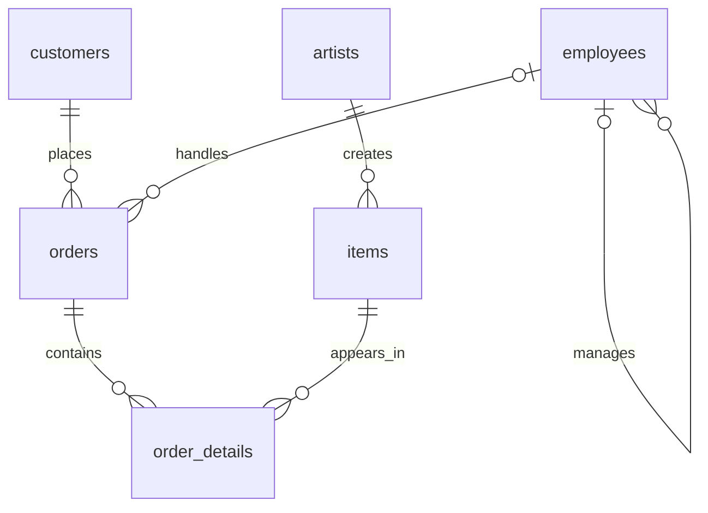

# Database design

| Table | Key | Purpose |
|---|---|---|
| customers | customer_id | Fictional customer contact and location attributes |
| artists | artist_id | Artist names |
| items | item_id | Catalog title, artist and current unit price |
| employees | employee_id | Employee names and optional manager |
| orders | order_id | Customer, optional employee, order and shipment dates |
| order_details | order_id + item_id | Quantity of an item on an order |

An order belongs to one customer and can have multiple item lines. An item belongs to one artist and can appear on many orders. A manager can supervise multiple employees; an employee has at most one manager. Root managers have NULL manager_id.

The demo enforces referential integrity, nonnegative prices, positive quantities and shipment dates not earlier than order dates. The employee self-reference prevents direct self-management but is not a general cycle-detection algorithm.

The schema intentionally follows the course's music-retail model. It stores current catalog prices, not historical sale prices, so order-line quantities must not be presented as historical revenue.
